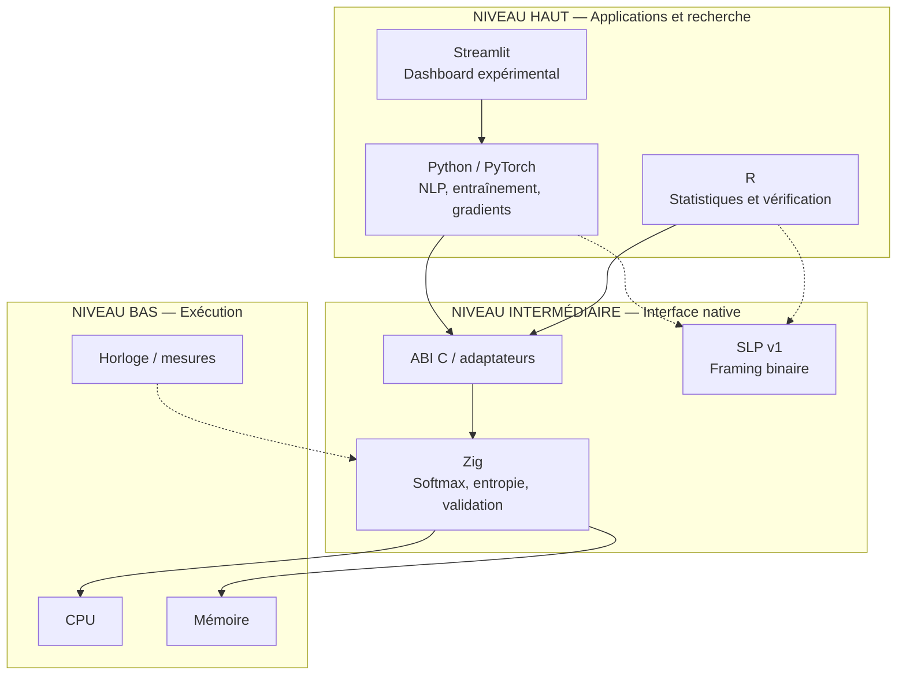
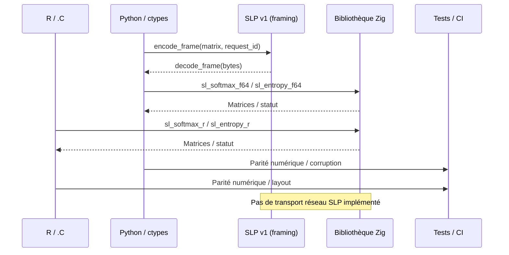
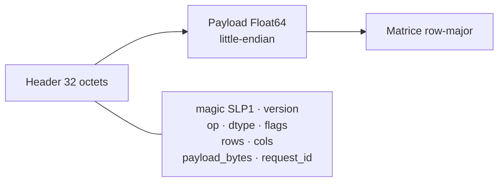
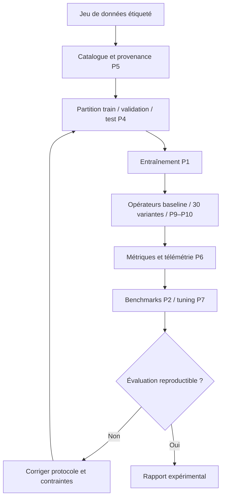
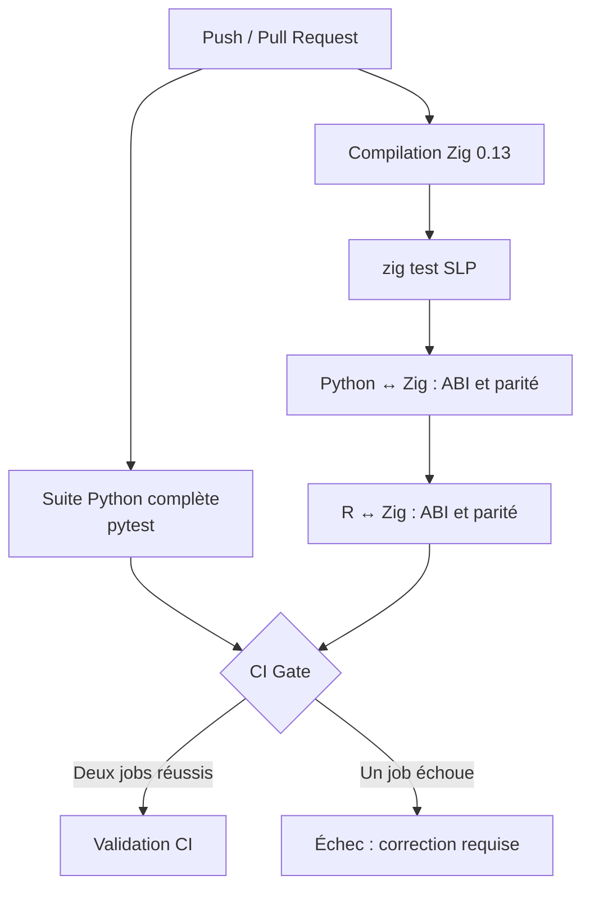
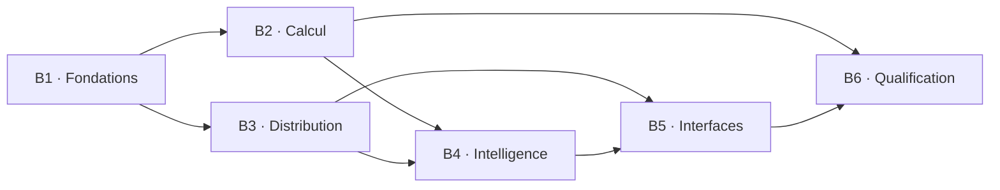

# Semantic Liquidity NLP
### Laboratoire expérimental de calcul sémantique — Python × R × Zig × SLP

[](https://github.com/tlpp7/semantic-liquidity-nlp/actions/workflows/ci.yml)
[](https://github.com/tlpp7/semantic-liquidity-nlp/actions/workflows/slp-circuit.yml)


> **Objet :** étudier des opérateurs sémantiques différentiables, comparer leurs comportements mathématiques, entraîner des modèles NLP et expérimenter un circuit de calcul natif interopérable R ↔ Zig ↔ Python. **Projet de recherche et d'ingénierie, non qualifié pour la production.**

**Navigation :** [Vue d'ensemble](#vue-densemble) · [Architecture](#architecture-en-trois-niveaux) · [Circuit SLP](#protocole-slp-v1) · [Mathématiques](#modèle-mathématique) · [Installation](#démarrage-rapide) · [Tests](#validation-et-ci) · [Roadmap](#feuille-de-route-p10p45) · [Limites](#limites-et-sécurité)

---

## Vue d'ensemble

Le dépôt contient **30 variantes d'opérateurs PyTorch** réparties en six familles, un classifieur de texte supervisé (embedding + GRU bidirectionnel), des outils d'entraînement et de benchmarking, une mémoire de replay, des expérimentations de couplage et de graphes de prototypes, ainsi qu'un **prototype de noyaux Zig** (Softmax et entropie) utilisables depuis Python et R.

| Domaine | Composant existant | Statut / portée |
|---|---|---|
| NLP | 30 opérateurs, entraînement, métriques et checkpoints | Prototype fonctionnel |
| Recherche | Benchmarks, validation, Optuna, replay/EWC | Expérimental |
| Graphes | Couplage P9 et prototypes P10 | PyTorch, expérimental |
| Calcul natif | Zig Softmax / entropie, ABI C, pont Python/R | Prototype CPU |
| Protocole | SLP v1 : encodage/décodage de matrices | **Framing binaire**, pas de réseau |
| Visualisation | Tableau de bord Streamlit | Disponible |
| Web D3.js / Three.js, DAG, agents | P28–P39 | **Planifié**, pas livré |
| Transport TCP/TLS et orchestration distribuée | P22–P27 | **Planifié**, pas livré |

## Architecture en trois niveaux



**Attention :** R est un langage de haut niveau ; il peut participer aux calculs natifs en appelant l'ABI Zig. L'horloge mesure et synchronise, mais n'effectue pas elle-même les opérations arithmétiques.

### Circuit d'exécution réellement couvert par les tests



**À distinguer :** le round-trip SLP et les appels natifs Zig sont testés ; cela ne signifie pas qu'une requête SLP traverse déjà un serveur TCP ou un bus IPC.

## Protocole SLP v1

**Semantic Liquidity Protocol (SLP)** : format binaire expérimental de trames de matrices.



| Champ | Encodage |
|---|---|
| Magic | `SLP1` |
| Version | `1` |
| Opération | `1` Softmax ; `2` entropie |
| Dtype | `1` = Float64 |
| Dimensions | `rows: u32`, `cols: u32` |
| Taille de charge | `payload_bytes: u64` |
| Corrélation | `request_id: u64` |
| Ordre des octets | Little-endian ; matrices row-major |
| Taille maximale | 128 MiB de payload |

La trame n'est **ni chiffrée ni authentifiée**. Ne pas l'exposer directement à Internet. Le transport réseau, la négociation de versions et les contrôles de sécurité sont des objectifs de roadmap.

## Modèle mathématique

Pour une représentation `X` et des prototypes `M` de dimension `d` :

```math
S = \frac{XM^\top}{\sqrt d}
```

```math
P_{ij}=\frac{\exp(S_{ij}-\max_k S_{ik})}{\sum_k\exp(S_{ik}-\max_k S_{ik})}
```

```math
H_i=-\frac{\sum_j P_{ij}\log(P_{ij})}{\log K}
```

Invariants numériques : `P >= 0`, somme des probabilités par ligne proche de `1`, entropie normalisée dans `[0, 1]` sous hypothèses valides. La bibliothèque Zig n'implémente pas automatiquement la rétropropagation PyTorch.

### Cycle expérimental



## Démarrage rapide

**Pré-requis :** Python ≥ 3.10. Les fonctionnalités Zig et R nécessitent leurs toolchains respectives.

```bash
git clone https://github.com/tlpp7/semantic-liquidity-nlp.git
cd semantic-liquidity-nlp
python -m pip install -e ".[dev,lab]"
python -m pytest -q
streamlit run dashboard/app.py
```

Pour installer uniquement les dépendances de test : `python -m pip install -e ".[dev]"`.

### Préparer les données

Le dashboard accepte un CSV étiqueté (`text`, `target`). Le catalogue permet d'enregistrer source, licence déclarée, classes et empreinte SHA-256 :

```bash
python scripts/catalog.py csv my_dataset.csv --text-col text --label-col target --license CC0
python scripts/catalog.py list
```

Téléchargement Kaggle optionnel : `python scripts/kaggle_download.py owner/dataset-name`. Authentification et droits de réutilisation restent à vérifier.

### Entraîner et comparer

```bash
python scripts/train.py --dataset storage/dataset.jsonl --operator baseline --epochs 5 --seed 42
python scripts/train.py --dataset storage/dataset.jsonl --operator coupled_v2 --epochs 5 --seed 42
python scripts/train.py --dataset storage/dataset.jsonl --operator graph_semantic --epochs 5 --seed 42

python scripts/benchmark.py --dataset storage/dataset.jsonl --operators baseline coupled_v2 graph_semantic --seeds 42 43 44 --epochs 5
```

Autres expériences :

```bash
python scripts/tune.py --dataset storage/dataset.jsonl --operators baseline softmax_beta coupled_dynamics --trials 12 --epochs 8
python scripts/continual.py --dataset storage/dataset.jsonl --tasks 3 --epochs 2 --ewc-lambda 1.0 --replay-capacity 256 --replay-samples 64
```

Les expériences enregistrent leurs sorties localement sous `storage/`. Les métriques, la stabilité et la généralisation doivent être évaluées sur des données appropriées.

## Validation et CI

La CI générale lance **deux branches de vérification**, puis une porte finale :



- [CI générale](https://github.com/tlpp7/semantic-liquidity-nlp/actions/workflows/ci.yml)
- [Tests spécialisés SLP R–Zig–Python](https://github.com/tlpp7/semantic-liquidity-nlp/actions/workflows/slp-circuit.yml)
- [Issues de développement](https://github.com/tlpp7/semantic-liquidity-nlp/issues)

**Exécution manuelle du noyau natif (Zig 0.13) :**

```bash
zig build-lib -dynamic -O ReleaseSafe native/zig/combined.zig -femit-bin=libsemantic_core.so
zig test native/zig/slp_protocol.zig
SLP_ZIG_LIBRARY="$PWD/libsemantic_core.so" python -m pytest -q tests/test_slp_circuit.py
SLP_ZIG_LIBRARY="$PWD/libsemantic_core.so" Rscript tests/test_slp_r_circuit.R
```

Commandes adaptées à Linux ; sous Windows/macOS, ajuster le nom de la bibliothèque partagée. Le workflow GitHub Actions constitue la référence automatisée.

## Feuille de route P10–P45

**Les six blocs suivants sont documentés et suivis par des issues ; ils ne sont pas tous implémentés.** Le P10 historique (graphe sémantique PyTorch) est distinct du P10 de la feuille de route d'industrialisation (audit du socle).

```mermaid
gantt
  title Roadmap logique — séquence indicative, sans dates promises
  dateFormat X
  axisFormat %s
  section Fondations
  Bloc 1 — P10 à P15 : b1, 0, 6
  section Noyaux
  Bloc 2 — P16 à P21 : b2, after b1, 6
  section Distribution
  Bloc 3 — P22 à P27 : b3, after b2, 6
  section Intelligence
  Bloc 4 — P28 à P33 : b4, after b3, 6
  section Interfaces
  Bloc 5 — P34 à P39 : b5, after b4, 6
  section Qualification
  Bloc 6 — P40 à P45 : b6, after b5, 6
```



| Bloc | Phases | Objectif | Détail |
|---|---|---|---|
| 1 | P10–P15 | Audit, contrat d'opérateurs, SLP v2, IPC et dispatch | [Roadmap 1](docs/ROADMAP_BLOCK_1_P10_P15.md) |
| 2 | P16–P21 | Algèbre native, SIMD, graphes, gradients et benchmarks | [Roadmap 2](docs/ROADMAP_BLOCK_2_P16_P21.md) |
| 3 | P22–P27 | TCP/TLS, nœuds distribués, reprise et sécurité | [Roadmap 3](docs/ROADMAP_BLOCK_3_P22_P27.md) |
| 4 | P28–P33 | DAG, recherche d'architectures, mémoire, MPC, agents | [Roadmap 4](docs/ROADMAP_BLOCK_4_P28_P33.md) |
| 5 | P34–P39 | API, interface web, D3.js, Three.js, éditeur DAG | [Roadmap 5](docs/ROADMAP_BLOCK_5_P34_P39.md) |
| 6 | P40–P45 | Validation scientifique, CI/CD, déploiement et v1.0 | [Roadmap 6](docs/ROADMAP_BLOCK_6_P40_P45.md) |

### Vue des dépendances



Les **36 issues ouvertes** correspondent aux tâches de la roadmap et ne sont pas 36 bugs identifiés.

## Structure du dépôt

```text
src/semantic_liquidity/   # Opérateurs, NLP, mémoire, entraînement, validation
native/zig/               # Noyaux CPU, ABI R, SLP
r/                        # Référence mathématique et pont natif
scripts/                  # CLI train, benchmark, tuning, protocole, bridge
dashboard/                # Interface Streamlit
tests/                    # Tests Python et R
docs/                     # Architecture et six blocs de roadmap
.github/workflows/        # CI générale et circuit SLP
storage/                  # Données et artefacts locaux (ignorés par Git)
```

Documentation technique : [Architecture à trois niveaux](docs/THREE_LEVEL_ARCHITECTURE.md) · [Synthèse P0–P10](docs/PRESENTATION_P0_P10.md).

## Limites et sécurité

- Les opérateurs sémantiques, la plasticité et la consolidation sont des **proxies mathématiques** ; aucune équivalence biologique n'est établie.
- Les comparaisons de modèles ne prouvent pas de supériorité sans baselines contrôlées, graines multiples et tests indépendants.
- L'évaluation actuelle de l'apprentissage continu réutilise des données d'entraînement : **ce n'est pas un benchmark held-out**.
- La sélection top-k des voisins dans les graphes est seulement différentiable par morceaux.
- La parité des noyaux Zig/R/Python ne prouve ni la sûreté réseau ni l'existence d'un protocole distribué opérationnel.
- Ne jamais publier de tokens Kaggle, secrets, données privées, checkpoints ou traces contenant des informations sensibles.

**Licence :** MIT. Voir le fichier de licence du dépôt.
