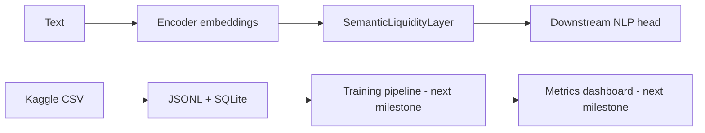

# Semantic Liquidity NLP

Public research prototype for **semantic liquidity**: context-sensitive meaning selection under uncertainty, plasticity, and stability constraints.

## P0 foundation
- **30 differentiable PyTorch operators** across six families: activation, uncertainty, plasticity proxies, flexibility, consolidation proxies, and coupled dynamics.
- Dataset ingestion from CSV to JSONL with SQLite registry.
- Kaggle dataset download CLI (requires your own Kaggle credentials and license/terms compliance).
- Streamlit dashboard to import data, inspect operators and view dataset registry.
- GitHub Actions tests (30 operator gradient checks + 2 basic checks).

**Scientific status:** these operators are hypotheses and differentiable mathematical proxies. In particular STDP and hippocampal/cortical consolidation here are not biologically faithful simulations. No benchmark improvement is claimed.

## Install
```bash
python -m pip install -e ".[dev,lab]"
pytest -q
streamlit run dashboard/app.py
```

## Kaggle import
```bash
python scripts/kaggle_download.py owner/dataset-name
```
Then import a suitable CSV in the dashboard, specifying text and label column names.

## API
```python
import torch
from semantic_liquidity import SemanticLiquidityLayer, OPERATOR_NAMES
layer = SemanticLiquidityLayer(dim=64, operator="coupled_dynamics")
output = layer(torch.randn(2, 12, 64))
```

## Architecture


## Roadmap
- **P0**: public repository, 30 mathematical operators, dataset registry, dashboard scaffold, CI.
- **P1**: real NLP training, train/validation/test splits, metrics and model checkpoints.
- **P2**: benchmark all operators against controlled baselines, multiple seeds and ablations.
- **P3**: continual learning, calibrated uncertainty, semantic visualization, remote artifact storage.

## Data and security
Never commit Kaggle API tokens, personal datasets, raw corpora or model checkpoints. Local artifacts are gitignored. Review each dataset license before use.

MIT license.
