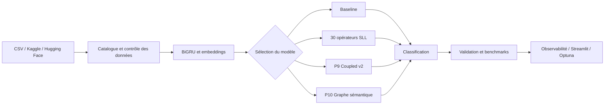

# Semantic Liquidity NLP — Présentation synthétique (P0–P10)

## Vision
Plateforme expérimentale NLP PyTorch visant à étudier des opérateurs de routage sémantique, des mécanismes de mémoire et des graphes de prototypes. Aucun gain prédictif n'est revendiqué sans évaluation indépendante.

## Architecture


## Phases publiées
| Phase | Contenu | Statut |
| --- | --- | --- |
| P0 | 30 opérateurs, architecture et CI | Code publié |
| P1 | Entraînement BiGRU, checkpoint et métriques | Code publié |
| P2 | Benchmark multi-seeds et classement | Code publié |
| P3 | EWC, apprentissage continu et diagnostics | Code publié |
| P4 | Stratification, fuites et bootstrap | Partiel |
| P5 | Catalogue SHA-256, provenance, import | Partiel |
| P6 | Télémétrie RAM/CUDA et gradients | Partiel |
| P7 | Optuna et sélection sur validation | Partiel |
| P8 | Experience replay avec réservoir | Partiel |
| P9 | Couplage entropie / température / plasticité simulée | Prototype publié |
| P10 | Graphe de prototypes et propagation différentiable | Prototype publié |

## Nouveaux modèles
- **P9 `coupled_v2`** : routage vers prototypes, température bornée, entropie normalisée, porte de plasticité apprise et contrôle de stabilité.
- **P10 `graph_semantic`** : voisinage top-k entre prototypes, matrice d'adjacence normalisée, propagation de messages et représentation contextuelle.
- Les 30 opérateurs historiques restent disponibles.

## Exécution
```bash
pip install -e ".[dev,lab]"
pytest -q
python scripts/train.py --dataset storage/dataset.jsonl --operator coupled_v2 --epochs 3
python scripts/train.py --dataset storage/dataset.jsonl --operator graph_semantic --epochs 3
python scripts/benchmark.py --dataset storage/dataset.jsonl --operators baseline coupled_v2 graph_semantic --seeds 42 43 44 --epochs 5
streamlit run dashboard/app.py
```

## Évaluation et limites
Les visualisations P9/P10 utilisent des prototypes non entraînés pour illustrer les mécanismes. La validité scientifique nécessite une CI réussie, des corpus externes, plusieurs seeds, des ablations et des budgets de calcul comparables. Les proxys de plasticité ne sont pas des simulations neuroscientifiques validées.

## Suite
P11 : recherche d'architecture ; P12 : calcul distribué ; P13 : registre des modèles.
