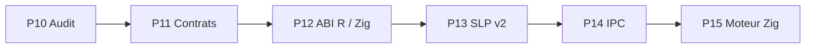

# Bloc 1 — P10 à P15 · Fondations R × Zig × SLP

**Objectif :** construire une chaîne native R ↔ Zig fiable, puis un protocole SLP versionné permettant de communiquer entre processus. R participe aux calculs via une interface native, Zig pilote le moteur de calcul et le protocole transporte des matrices et des résultats.

> Important : la présence d'un fichier source ne prouve ni sa compilation ni son exécution. Le format SLP1 actuel n'est pas encore un transport réseau.

## Enchaînement

## Phases

| Phase | Cible | Dépendances | État initial |
|---|---|---|---|
| P10 | Audit et stabilisation du socle R/Zig/SLP | Aucune | À qualifier |
| P11 | Contrat universel des opérateurs | P10 | À qualifier |
| P12 | Couche native R et parité R/Zig/Python | P10, P11 | À qualifier |
| P13 | SLP v2 : enveloppe de requêtes et réponses | P11, P12 | À qualifier |
| P14 | Transport IPC local SLP | P13 | À qualifier |
| P15 | Moteur Zig de dispatch et observabilité | P14 | À qualifier |

## Invariants transversaux

- Matrices Float64 et convention row-major explicite à la frontière native.
- Contrôle des dimensions, non-finitude, endianness et budgets mémoire.
- Codes d'erreurs stables et rejet sans ambiguïté des messages invalides.
- Parité R/Python/Zig à tolérance documentée, avec benchmarks et traces.
- Séparer format binaire, ABI native et transport IPC : trois couches distinctes.
- Ne pas prétendre qu'une interface native préserve autograd PyTorch.

## Definition of Done

Pour chaque phase : source + documentation + tests automatiques + exemples reproductibles + résultats CI; les performances doivent être mesurées, pas supposées.

## Détail

### P10 — Audit et stabilisation du socle R/Zig/SLP

**Travail :** Inventorier le code P9/P10, les ABI et l'en-tête SLP1; compiler Zig sur version épinglée; exécuter tests et relever écarts.

**Livrables :** Rapport d'audit, versions prises en charge, tests de non-régression et correctifs.

**Validation :** Tous les tests du socle passent; aucune incompatibilité ABI non documentée.

**Dépendances :** Aucune.

### P11 — Contrat universel des opérateurs

**Travail :** Spécifier operation/version/dtype/shape/parameters/input/output/diagnostics; convention row-major, endianness, unités, codes d'erreurs et limites; schémas JSON et binaire.

**Livrables :** Spécification normative, validateurs R/Python/Zig, fixtures de compatibilité.

**Validation :** Messages invalides rejetés; fixtures identiques entre langages; compatibilité versionnée.

**Dépendances :** P10.

### P12 — Couche native R et parité R/Zig/Python

**Travail :** Valider .C avec adaptateur ABI et étudier .Call via wrapper C/R API; définir ownership et durée de vie des buffers, copies, alignement et NA/NaN; jeux de tests indépendants.

**Livrables :** Bridge R natif compilable, tests de parité softmax/entropie, mesures des conversions.

**Validation :** Parité numérique documentée, pas de corruption mémoire, tests Linux/macOS/Windows selon support.

**Dépendances :** P10, P11.

### P13 — SLP v2 : enveloppe de requêtes et réponses

**Travail :** Définir trames request/response/error, correlation id, opérations, versions, taille, checksum éventuel, budget mémoire et statuts; encodeurs et décodeurs R/Python/Zig.

**Livrables :** Spécification SLP v2, encodeurs/décodeurs, golden vectors, tests de fuzzing hors réseau.

**Validation :** Roundtrip interlangages; rejet strict des trames tronquées ou malformées; limites de taille vérifiées.

**Dépendances :** P11, P12.

### P14 — Transport IPC local SLP

**Travail :** Implémenter client R et serveur Zig séparés via socket Unix / transport local multiplateforme; framing longueur, timeouts, reconnexion, annulation et erreurs.

**Livrables :** Client/serveur local avec exemple reproductible R→Zig→R et tests d'intégration.

**Validation :** 1000 requêtes locales sans corruption/perte; timeout et fermeture testés; latence mesurée.

**Dépendances :** P13.

### P15 — Moteur Zig de dispatch et observabilité

**Travail :** Implémenter registre d'opérateurs, dispatch, quotas et files bornées, buffers et allocations contrôlés; erreurs homogènes; métriques latence, débit, RAM, erreurs.

**Livrables :** Moteur local, CLI de diagnostic, métriques structurées et microbenchmarks.

**Validation :** Chaîne R→SLP→Zig→R stable avec Softmax/entropie et tests charge/erreur; comparaison à baseline R.

**Dépendances :** P14.

