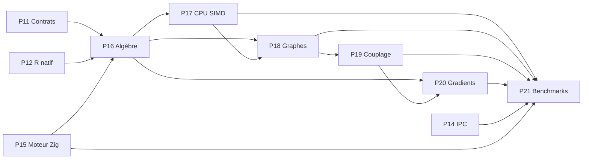

# Bloc 2 — P16 à P21 · Calcul mathématique et optimisation R × Zig × SLP

**But :** disposer de noyaux mathématiques natifs corrects, accélérables et interopérables, avec preuves de parité numérique avant toute affirmation de performance.

**État : planification, non implémenté par cette roadmap.** Les fonctions expérimentales existantes servent de base, sans validation implicite.

## Dépendances

## Phases

| Phase | Objectif | Dépendances |
|---|---|---|
| P16 | Algèbre native R/Zig : matrices, tenseurs et opérations | P11, P12, P15 |
| P17 | Optimisation CPU : SIMD, parallélisme et mémoire | P16 |
| P18 | Moteur natif de graphes sémantiques | P16, P17 |
| P19 | Couplage mathématique : entropie, température, plasticité et mémoire | P18 |
| P20 | Différentiation et compatibilité autograd | P16, P19 |
| P21 | Benchmarks scientifiques R/Zig/Python et bilan performances | P17, P18, P19, P20, P14, P15 |

## Contrats et contrôles transversaux
- R est un langage de haut niveau qui participe à la couche de calcul native via ses interfaces C; Zig contient les noyaux, SLP transporte les messages.
- Tests de valeurs non finies, de dimensions, d'endianness, d'alignement, de mémoire et d'erreurs.
- Conversion explicite de l'ordre mémoire R (column-major) vers l'ABI Zig (row-major).
- Pour tous les benchmarks : versions, matériel, taille des matrices, répétitions, échauffement, p50/p95 et intervalles de confiance.
- Comparaison avec implémentations de référence R, NumPy, PyTorch et BLAS selon l'opération.
- Zéro affirmation de gain de performance sans données reproduites; les gradients automatiques exigent un backward explicite.

## Définition de terminé
Source + documentation + tests unitaires et d'intégration + CI vérifiée + validation de parité + benchmarks reproductibles si pertinent.

## P16 — Algèbre native R/Zig : matrices, tenseurs et opérations

**Travaux :** Implémenter kernels Zig pour produits matriciels, normalisation, softmax stable, entropie et transformations tensorielles; définir dtype, strides, ordre mémoire, taille et erreurs; exposer interfaces R et Python.

**Livrables :** Noyaux natifs, adaptateurs R/Python, fixtures mathématiques et documentation des contrats.

**Acceptation :** Parité R/Zig/Python sur jeux déterministes et aléatoires; limites dimensions/valeurs non finies testées; zéro corruption mémoire.

**Dépendances :** P11, P12, P15.

## P17 — Optimisation CPU : SIMD, parallélisme et mémoire

**Travaux :** Profiler kernels P16 puis comparer implémentations scalaire, vectorisée SIMD, multithread et BLAS optimisé; mesurer coûts de copie R↔Zig et taille des buffers; choisir des stratégies selon la taille des données.

**Livrables :** Benchmarks reproductibles, profils CPU, tableaux latence/débit/allocations, choix de configuration explicites.

**Acceptation :** Rapporter médiane et p95, configuration CPU et versions; vérifier parité numérique et absence de régression avant toute optimisation.

**Dépendances :** P16.

## P18 — Moteur natif de graphes sémantiques

**Travaux :** Implémenter représentations denses et creuses (CSR), k-plus proches voisins, arêtes pondérées, adjacence normalisée, propagation et mises à jour contrôlées; interfaces pour les prototypes P10.

**Livrables :** Structures de graphes Zig, APIs R/Python et algorithmes de propagation.

**Acceptation :** Tests sur graphes vides/déconnectés/fortement connectés; vérification conservation/normalisation et accord avec référence Python/R.

**Dépendances :** P16, P17.

## P19 — Couplage mathématique : entropie, température, plasticité et mémoire

**Travaux :** Formaliser et implémenter les couplages P9/P10 en DAG, contraintes de stabilité, entropie cible, variation de température, portes de plasticité et mémoire; distinguer heuristique de modèle appris.

**Livrables :** Spécifications des opérateurs couplés, kernels ou compositions Zig, diagnostics R et tests de propriétés.

**Acceptation :** Invariants de bornes et stabilité vérifiés; tests de sensibilité, effets de paramètres et ablations reproductibles.

**Dépendances :** P18.

## P20 — Différentiation et compatibilité autograd

**Travaux :** Définir jacobiens/VJP pour kernels prioritaires, vérifier gradients par différences finies et comparer à PyTorch; ajouter autograd.Function et échanger les buffers sans supposer la différentiabilité de l'ABI native.

**Livrables :** Backward explicite pour opérateurs choisis, wrappers PyTorch, tests gradcheck et documentation des limites.

**Acceptation :** Gradcheck satisfait à tolérances déclarées; comparaison forward/backward avec références; erreurs de gradient documentées.

**Dépendances :** P16, P19.

## P21 — Benchmarks scientifiques R/Zig/Python et bilan performances

**Travaux :** Comparer noyaux et chaîne complète R↔SLP↔Zig↔R (si P14/P15 finalisés) à R seul, NumPy et PyTorch CPU; mesurer latence, débit, RAM, latence de sérialisation, stabilité numérique et puissance uniquement si instrumentée.

**Livrables :** Suite benchmark reproductible, jeux de données, graphiques R, tableau résultats et rapport de décision.

**Acceptation :** Runs répliqués, médianes/p95/IC, configuration et limites indiquées; aucun gain de vitesse affirmé sans mesure, effets de copies inclus.

**Dépendances :** P17, P18, P19, P20, P14, P15.

Voir aussi [Bloc 1 — P10 à P15](ROADMAP_BLOCK_1_P10_P15.md).
