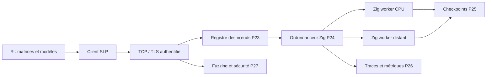
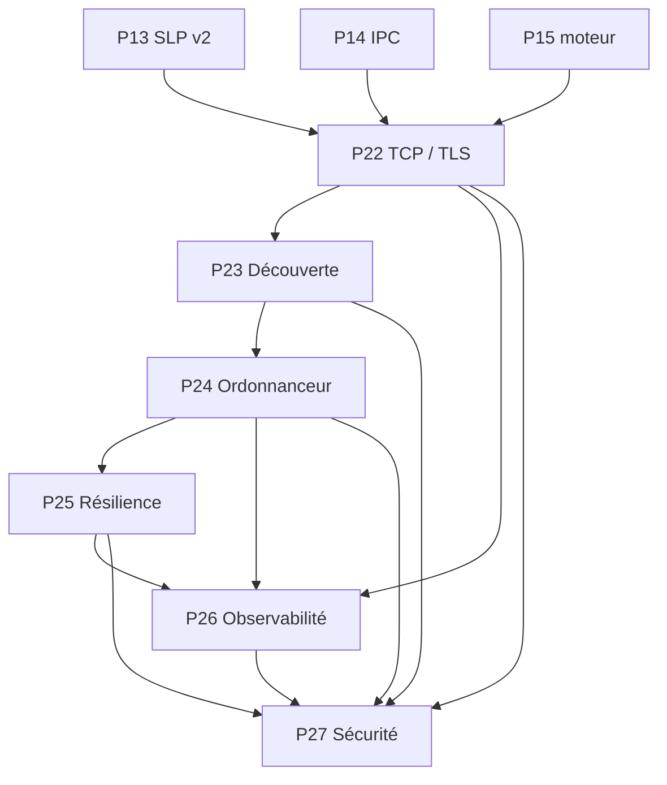

# Bloc 3 — P22 à P27 : exécution distribuée, fiabilité et sécurité SLP

**Objectif :** transformer le transport local SLP en communication réseau authentifiée, puis en système distribué contrôlable, observable et résilient.

**Statut initial : planifié.** Ce document ne déclare pas le code développé, testé ou exploitable en production. Le déploiement public est interdit tant que les protections P22 et P27 ne sont pas vérifiées.

## Flux cible

## Dépendances

## Phases

| Phase | Périmètre | Dépendances |
|---|---|---|
| P22 | Transport SLP sécurisé sur TCP/TLS | P13, P14, P15 |
| P23 | Découverte des nœuds et négociation de capacités | P22 |
| P24 | Ordonnanceur distribué Zig et contrôle des ressources | P23, P15, P28 (pour DAG générique, ou sous-ensemble DAG minimal ici) |
| P25 | Tolérance aux pannes : idempotence, retries et checkpoints | P24 |
| P26 | Observabilité distribuée et diagnostic | P22, P24, P25 |
| P27 | Sécurisation et qualification du protocole SLP | P22–P26 |

## Contraintes systématiques

- Toute trame SLP est bornée en octets, dimensions, temps et nombre de ressources.
- Les identités de nœuds et d'utilisateurs sont vérifiées ; ne jamais exposer un service TCP SLP nu sur Internet.
- Les réponses conservent les identifiants de requête et de trace pour permettre la corrélation R ↔ Zig.
- Toute tâche possède un statut explicite et des règles d'annulation, de retry, d'expiration et de déduplication.
- Les traces ne contiennent ni charge utile confidentielle ni secrets. Les quotas empêchent la saturation d'un nœud.
- L'intégration des gradients PyTorch et les performances distribuées doivent être validées indépendamment.
- La disponibilité du bloc P28 pour le DAG générique n'est **pas** une condition bloquante de P24 : un format de jobs minimal peut être spécifié dans P24, puis étendu en P28.

## Definition of Done

Tests unitaires, intégration multi-processus, scénarios de panne, CI, documentation exploitable, métriques reproduites, validation de sécurité et restrictions d'accès.

## P22 — Transport SLP sécurisé sur TCP/TLS

**Travail :** Développer un transport TCP à trames explicites, protéger la connexion par TLS avec vérification d'identité, définir les paramètres de session, authentification et autorisation, limiter taille et fréquence des messages. Séparer enveloppe SLP et transport.

**Livrables :** Clients R/Python et serveur Zig compatibles, tests d'intégration TLS, documentation de configuration et modèle de menace.

**Critères d'acceptation :** Échange R → SLP/TLS → Zig → R fonctionnel sur deux processus; certificats invalides et clients non autorisés refusés; tests de timeout, charge et trames malformées.

**Dépendances :** P13, P14, P15.

## P23 — Découverte des nœuds et négociation de capacités

**Travail :** Implémenter un registre de nœuds authentifiés, annonces de capacités (opérateurs, versions SLP, dtype, taille maximale, CPU/GPU), heartbeat et expiration des entrées; négocier une version commune sans downgrade silencieux.

**Livrables :** Registre de capacités, handshake versionné, tests de compatibilité et schéma des annonces.

**Critères d'acceptation :** Rejet des versions incompatibles; expirations et reconnexions déterministes; aucun nœud non authentifié dans le registre.

**Dépendances :** P22.

## P24 — Ordonnanceur distribué Zig et contrôle des ressources

**Travail :** Orchestrer jobs et DAG entre nœuds, avec files bornées, priorité, quotas, backpressure, placement fondé sur les capacités, IDs de tâches et propagation de l'annulation.

**Livrables :** Scheduler Zig documenté, contrats de jobs, politiques de placement et mesures de charge.

**Critères d'acceptation :** Pas de dépassement des quotas définis; backpressure testée; ordre/priorités reproductibles dans les scénarios déterministes; pas de perte silencieuse de tâches.

**Dépendances :** P23, P15, P28 (pour DAG générique, ou sous-ensemble DAG minimal ici).

## P25 — Tolérance aux pannes : idempotence, retries et checkpoints

**Travail :** Définir classes d'erreurs réessayables, clés d'idempotence, délais et retries plafonnés, déduplication, annulation, checkpoints versionnés et reprise après redémarrage; spécifier la sémantique de livraison.

**Livrables :** Stratégie de reprise, stockage des checkpoints, tests d'injection de fautes, documentation at-least-once et déduplication.

**Critères d'acceptation :** Absence de doublons d'effets pour les opérations idempotentes; reprise après coupure vérifiée; budget de retry et expiration contrôlés.

**Dépendances :** P24.

## P26 — Observabilité distribuée et diagnostic

**Travail :** Instrumenter chaque étape R → SLP → Zig avec request_id/trace_id, latence, débit, mémoire, saturation des files, taux d'erreurs et traces OpenTelemetry si compatibles; anonymiser les données sensibles.

**Livrables :** Journalisation structurée, métriques exportables, dashboards et scénarios de diagnostic de bout en bout.

**Critères d'acceptation :** Une requête identifiable d'un bout à l'autre; calcul p50/p95/p99 documenté; contrôles de cardinalité et absence de données sensibles dans les logs.

**Dépendances :** P22, P24, P25.

## P27 — Sécurisation et qualification du protocole SLP

**Travail :** Mettre en place fuzzing des décodeurs Zig/R/Python, tests adversariaux des trames, limites CPU/mémoire, gestion des secrets, audits dépendances et analyse des surfaces TCP/TLS, ordonnanceur, endpoints et fichiers de checkpoints.

**Livrables :** Corpus de fuzzing, rapport de modèle de menace, analyses automatisées, tests de robustesse et politique de correction.

**Critères d'acceptation :** Aucun crash non maîtrisé sur corpus de fuzzing; trames incohérentes rejetées; permissions minimales et limites de ressources vérifiées; risques résiduels documentés.

**Dépendances :** P22–P26.

Références : [Bloc 1 P10–P15](ROADMAP_BLOCK_1_P10_P15.md) et [Bloc 2 P16–P21](ROADMAP_BLOCK_2_P16_P21.md).
