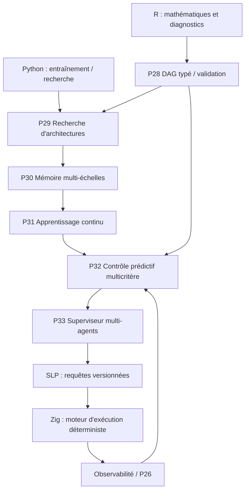
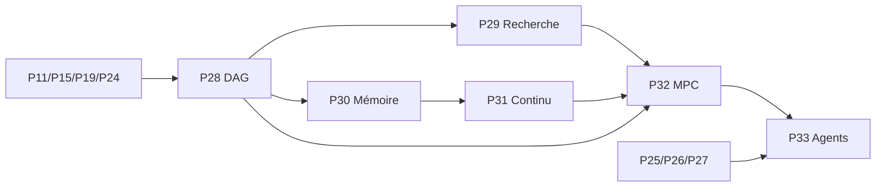

# Bloc 4 — P28 à P33 : intelligence et optimisation adaptative

**Objectif :** composer les opérateurs sémantiques en graphes de calcul vérifiables, optimiser l'architecture et le contrôle sous contraintes, puis coordonner des agents audités au-dessus du moteur R × SLP × Zig.

**Statut : planification.** Cette feuille de route n'implémente pas les phases. Les résultats scientifiques et gains de performances restent à établir.

## Architecture cible

## Dépendances

## Phases et critères

| Phase | Objectif | Prérequis |
|---|---|---|
| P28 | Graphe d’exécution composable et validation de DAG | P11, P15, P19, P24 |
| P29 | Recherche d’architectures sous contraintes | P21, P28 |
| P30 | Mémoire sémantique multi-échelles | P8, P19, P28 |
| P31 | Apprentissage continu et résistance à la dérive | P3, P4, P30 |
| P32 | Contrôle prédictif multicritère et Pareto | P21, P24, P28, P29, P31 |
| P33 | Superviseur multi-agents vérifiable | P25, P26, P27, P28, P32 |

## Invariants transversaux

- **R** : calculs de référence, diagnostics, validation statistique; **Zig** : exécution et gestion des ressources; **SLP** : transport et contrats de données; **Python** : apprentissage et recherche.
- Un plan DAG incompatible est rejeté avant exécution, sans correction silencieuse.
- Le jeu de test n'est jamais utilisé pour sélectionner des architectures ou des hyperparamètres.
- Mémoire, temps, allocations et nombre d'essais sont bornés et journalisés.
- Les stratégies adaptatives doivent être comparées à des baselines simples avec des ablations.
- Les agents n'exécutent que des actions permises, tracées et validées; leurs sorties ne constituent jamais une autorisation implicite.
- Les données expérimentales et les métriques ne doivent pas être présentées comme validation scientifique avant reproduction indépendante.

## Definition of Done

Code revu, tests unitaires/d'intégration, CI validée, exemples R/Zig/Python reproductibles, mesures et limites explicites, documentation.

## P28 — Graphe d’exécution composable et validation de DAG

**Travaux :** Définir un schéma de graphe orienté acyclique versionné (nœuds opérateurs, entrées/sorties typées, dépendances, contraintes, identifiants de calcul). Construire un validateur de cycles, compatibilité de formes, ordonnancement topologique et sérialisation interopérable R/Zig/Python.

**Livrables :** Schéma DAG, validateur, compilateur de plan d'exécution minimal, exemples de pipelines R→SLP→Zig.

**Validation :** Rejet des cycles, erreurs de dimensions, nœuds inconnus et versions incompatibles; même plan d’exécution sur R/Python/Zig; tests automatisés et CI.

**Dépendances :** P11, P15, P19, P24.

## P29 — Recherche d’architectures sous contraintes

**Travaux :** Composer automatiquement des opérateurs du catalogue (30 historiques + P9/P10), évaluer des configurations reproductibles et chercher sous contraintes de précision, mémoire, latence et stabilité; isoler jeu de validation et test.

**Livrables :** Moteur de recherche configurable, historique des essais, classement des architectures, traces des contraintes et rapport d'ablation.

**Validation :** Aucune fuite du jeu de test; mêmes seeds et données donnent des résultats reproductibles; budget mémoire/temps respecté; comparaison avec baseline.

**Dépendances :** P21, P28.

## P30 — Mémoire sémantique multi-échelles

**Travaux :** Spécifier une mémoire court terme, replay borné, consolidation long terme et politique d'oubli; relier aux représentations des prototypes et aux paramètres de couplage R/Zig; établir un budget mémoire fixe.

**Livrables :** API de mémoire versionnée, stratégies de rétention et récupération, snapshots et métriques de couverture/oubli.

**Validation :** Aucune croissance non bornée; restauration déterministe de snapshots; tests de dérive et de rétention; parité avec références R/Python.

**Dépendances :** P8, P19, P28.

## P31 — Apprentissage continu et résistance à la dérive

**Travaux :** Mesurer distribution shift, plasticité et oubli catastrophique; comparer replay, EWC, baselines figées et mémoire multi-échelles; intégrer des alertes de dérive et évaluations hors distribution.

**Livrables :** Pipeline d'évaluation continual, mesures d'oubli et transfert, jeux de tâches documentés, tableaux de bord.

**Validation :** Séparation stricte train/validation/test; scores et intervalles de confiance reproductibles; gain mesuré plutôt que supposé.

**Dépendances :** P3, P4, P30.

## P32 — Contrôle prédictif multicritère et Pareto

**Travaux :** Développer un superviseur à horizon glissant (MPC) qui choisit les plans d'exécution et paramètres de couplage selon qualité, coût de calcul, latence, stabilité et risque; comparer avec arbitrage minimal et négociation multicritère.

**Livrables :** Objectifs normalisés, contraintes explicites, stratégies MPC et baselines, surfaces/frontières de Pareto, journaux de décisions.

**Validation :** Respect des contraintes dures, suivi de marges de sécurité, mesures de regret/coût/latence; ablations et tests sur charges non stationnaires.

**Dépendances :** P21, P24, P28, P29, P31.

## P33 — Superviseur multi-agents vérifiable

**Travaux :** Créer des rôles planificateur, exécuteur, vérificateur, arbitre et auditeur; exécuter uniquement des plans validés; garder droits minimaux, quotas et traçabilité. Séparer raisonnement agent et moteur déterministe Zig.

**Livrables :** Contrats des agents, superviseur, journal d'audit, politiques d'autorisation, scénarios simulés, métriques de décisions.

**Validation :** Chaque action est attribuable et vérifiable; plans invalides rejetés; annulation et reprise testées; aucun accès réseau/outil hors autorisation; reproductibilité des scénarios déterministes.

**Dépendances :** P25, P26, P27, P28, P32.

## Références

- [Bloc 1 — P10–P15](ROADMAP_BLOCK_1_P10_P15.md)
- [Bloc 2 — P16–P21](ROADMAP_BLOCK_2_P16_P21.md)
- [Bloc 3 — P22–P27](ROADMAP_BLOCK_3_P22_P27.md)
