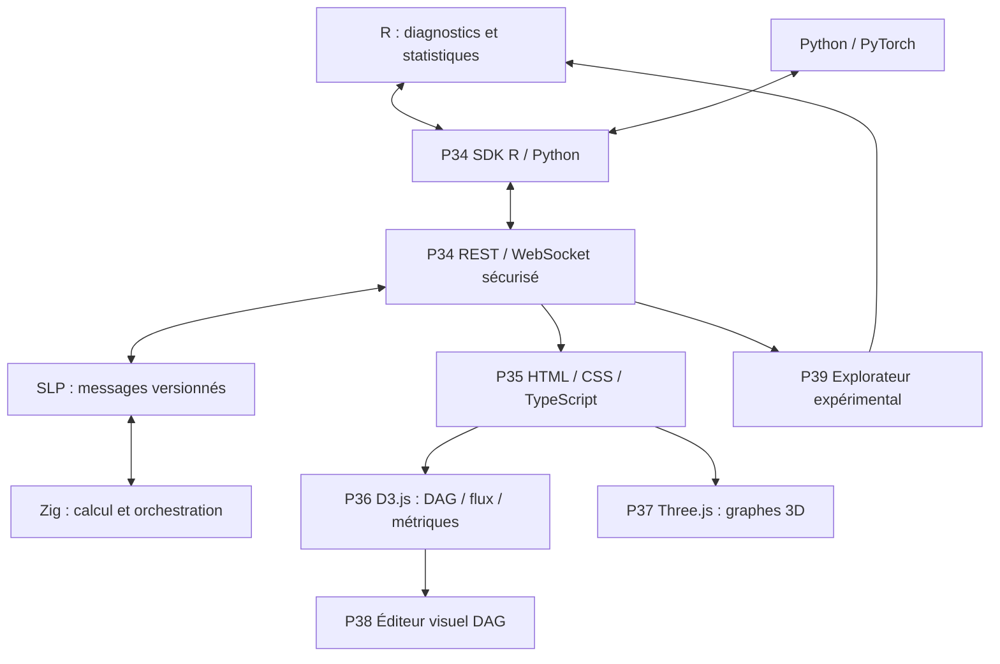
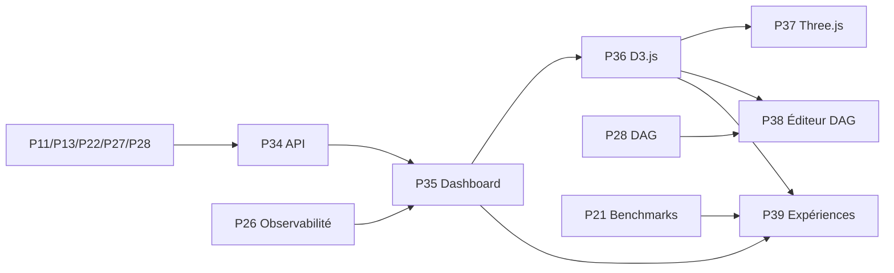

# Bloc 5 — P34 à P39 : API, interfaces et visualisation avancée

**Objectif :** rendre le moteur R × SLP × Zig accessible par des SDK et interfaces web, visualiser ses états, composer des graphes de calcul et étudier ses expériences sans compromettre sécurité ni reproductibilité.

**Statut : planifié, non implémenté par ce document.** Les fonctionnalités interactives dépendent des fondations des blocs précédents.

## Architecture cible

## Dépendances

## Planning détaillé

| Phase | Objectif | Dépendances |
|---|---|---|
| P34 | API publiques R/Python/REST et passerelle WebSocket | P11, P13, P22, P27, P28 |
| P35 | Interface web HTML/CSS/TypeScript et tableau de bord | P26, P34 |
| P36 | Visualisations interactives D3.js des flux et graphes | P28, P34, P35 |
| P37 | Visualisations 3D Three.js des prototypes et couches | P18, P34, P35, P36 |
| P38 | Éditeur visuel de graphes et exécution contrôlée | P27, P28, P34, P35, P36 |
| P39 | Explorateur expérimental R/Zig/Python et reproductibilité | P21, P26, P29, P31, P35, P36 |

## Règles d'architecture
- Une API publique ne contourne jamais l'authentification ni l'autorisation du moteur.
- Le protocole SLP reste derrière une passerelle sécurisée pour les navigateurs; WebSocket n'expose pas directement les ABI natives.
- Le frontend ne fait aucune confiance aux données externes; validation serveur obligatoire pour tout DAG soumis.
- Les vues D3.js et Three.js consomment des schémas stables et documentés; Three.js est une représentation, pas un résultat scientifique.
- Les graphiques doivent rester exploitables au clavier et via des alternatives tabulaires/accessibles; cible WCAG 2.2 AA.
- Les expériences exposent jeux de données, versions, seeds et configurations pour permettre les comparaisons en R.
- Débits, FPS, latences, consommation et efficacité sont mesurés; aucune amélioration n'est présumée.

## Définition de terminé
Code + schémas + documentation + tests E2E et accessibilité + CI + revues de sécurité + exemples reproductibles.

## P34 — API publiques R/Python/REST et passerelle WebSocket

**Travaux :** Définir un contrat d’API versionné au-dessus de SLP, exposer des SDK R/Python et une passerelle HTTP/WebSocket sécurisée. Gérer authentification, autorisation, limites de requêtes, erreurs, streaming, annulations et compatibilité de versions.

**Livrables :** Spécification OpenAPI, schémas d'événements WebSocket, SDK R/Python, exemples de communication et tests d’intégration.

**Validation :** Roundtrip entre API et noyaux Zig vérifié; messages et erreurs conformes aux schémas; contrôle d'accès, limites de charge et tests de compatibilité validés.

**Dépendances :** P11, P13, P22, P27, P28.

## P35 — Interface web HTML/CSS/TypeScript et tableau de bord

**Travaux :** Créer une application web accessible et responsive présentant les moteurs Zig, le statut des nœuds, les tâches, les graphes DAG, les traces et métriques. Prévoir état de chargement, erreurs, permissions et configuration.

**Livrables :** Architecture frontend, composants réutilisables, pages dashboard, jeux de données de démonstration et tests E2E.

**Validation :** Navigation au clavier et lecteur d'écran contrôlée; WCAG 2.2 AA visé et audité; tableaux temps réel résilients aux déconnexions; tests E2E et performance documentés.

**Dépendances :** P26, P34.

## P36 — Visualisations interactives D3.js des flux et graphes

**Travaux :** Implémenter diagrammes de flux, graphes de dépendances, matrices d'adjacence, timelines et visualisations de métriques avec zoom, filtrage, sélection liée et export. Utiliser des flux d'événements de la passerelle web.

**Livrables :** Bibliothèque de vues D3.js, schémas JSON d'entrée, exemples de DAG et tests de rendu.

**Validation :** Interactions souris/clavier vérifiées; graphes volumineux gérés avec limites documentées; cohérence avec données de référence R/Zig, export et accessibilité testés.

**Dépendances :** P28, P34, P35.

## P37 — Visualisations 3D Three.js des prototypes et couches

**Travaux :** Construire une scène 3D des prototypes, graphes sémantiques, couches de calcul et interconnexions; prévoir modes 2D de secours, limitations de rendu, choix de niveaux de détail et navigation contrôlée.

**Livrables :** Scène Three.js modulaire, adaptateurs de données du graphe, sélection interconnectée avec D3 et vues alternatives.

**Validation :** Rendu vérifié sur appareils cibles; vue 2D accessible disponible; FPS, RAM et latence mesurés; aucune représentation 3D présentée comme preuve scientifique.

**Dépendances :** P18, P34, P35, P36.

## P38 — Éditeur visuel de graphes et exécution contrôlée

**Travaux :** Créer un éditeur node-based permettant de composer opérateurs et DAG, modifier paramètres, visualiser types/dimensions et valider localement puis côté serveur avant exécution; inclure import/export, versionnement, annulation et aperçu des coûts.

**Livrables :** Éditeur DAG, sérialisation versionnée, validation, prévisualisation et lancement de tâches autorisées.

**Validation :** Cycles/types invalides refusés avant exécution; permissions vérifiées côté serveur; import/export sans perte; tests E2E et cas de restauration.

**Dépendances :** P27, P28, P34, P35, P36.

## P39 — Explorateur expérimental R/Zig/Python et reproductibilité

**Travaux :** Comparer runs et scénarios avec filtres, baselines, métriques statistiques, intervalles de confiance, provenance, export R/CSV/JSON et rapport synthétique; afficher seeds, versions et matériel.

**Livrables :** Explorateur d'expériences, stockage des métadonnées, exports reproductibles et visualisations comparatives.

**Validation :** Exécutions comparables et provenance inspectable; statistiques recalculables en R; aucune métrique absente inventée; tests d'export, pagination et cohérence.

**Dépendances :** P21, P26, P29, P31, P35, P36.

## Références
- [Bloc 1 P10–P15](ROADMAP_BLOCK_1_P10_P15.md)
- [Bloc 2 P16–P21](ROADMAP_BLOCK_2_P16_P21.md)
- [Bloc 3 P22–P27](ROADMAP_BLOCK_3_P22_P27.md)
- [Bloc 4 P28–P33](ROADMAP_BLOCK_4_P28_P33.md)
