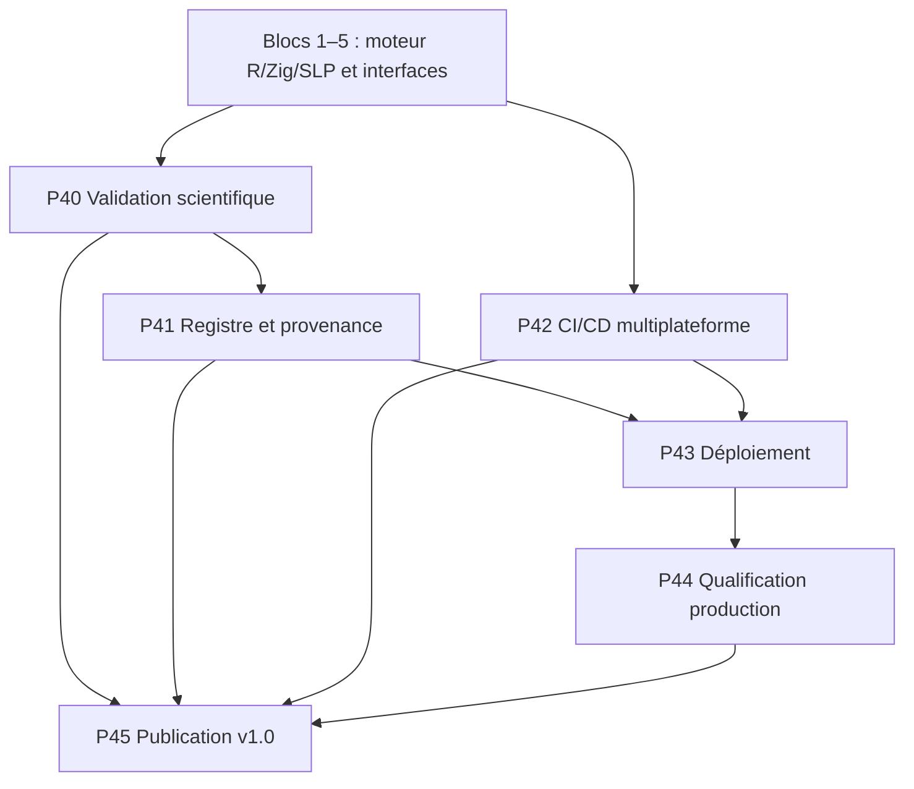

# Bloc 6 — P40 à P45 : validation scientifique et mise en production

**Objectif :** transformer R × Zig × SLP en plateforme qualifiée, reproductible, sécurisée et publiable en v1.0 — uniquement après vérification des phases antérieures.

**Statut : planification.** Ce fichier ne certifie ni résultat expérimental, ni conformité, ni aptitude production.

## Flux de qualification

## Phases

| Phase | Périmètre | Dépendances |
|---|---|---|
| P40 | Validation scientifique, ablations et généralisation externe | P19, P20, P21, P29, P31, P39 |
| P41 | Registre de modèles, provenance et promotion contrôlée | P5, P26, P33, P40 |
| P42 | CI/CD multiplateforme R, Zig, Python et web | P12, P13, P27, P34, P35, P40 |
| P43 | Déploiement, conteneurs et restauration | P22, P25, P27, P34, P41, P42 |
| P44 | Qualification production : charge, sécurité et objectifs de service | P21, P25, P26, P27, P39, P43 |
| P45 | Publication v1.0, SDK et documentation complète | P40, P41, P42, P43, P44 |

## Principes transversaux

- **R** assure la référence mathématique, les analyses de parité, les intervalles de confiance et les diagnostics reproductibles.
- **Zig** exécute les noyaux et le moteur natif; les limites CPU/mémoire, ABI et décodeurs sont qualifiées.
- **SLP** fait l'objet de tests de compatibilité, d'intégrité, d'autorisation et d'interopérabilité inter-processus.
- **Python/PyTorch** reste responsable des gradients appris et des protocoles d'entraînement contrôlés.
- **HTML/CSS/TypeScript, D3.js et Three.js** sont validés pour performances, accessibilité et sécurité.
- Les rapports précisent matériel, versions, seeds, jeux de données, répétitions, métriques et limites.
- Aucune promotion automatique en production sans portes de validation et approbation explicite.

## Definition of Done P45

Tests et CI au vert sur plateformes annoncées; validation externe documentée; registre et rollback fonctionnels; audit de sécurité sans vulnérabilité critique non traitée; publication versionnée et documentation accessible.

## P40 — Validation scientifique, ablations et généralisation externe

**Travaux :** Construire un protocole expérimental préenregistré avec baselines R, Zig, Python/PyTorch, ablations des couplages P9/P10 et DAG, ensembles externes et mesures de généralisation. Fixer métriques, seeds, tests statistiques, intervalles de confiance et procédures anti-fuite avant évaluation.

**Livrables :** Plan expérimental versionné, corpus et provenance, scripts R/Python, résultats comparatifs, rapport de reproductibilité.

**Critères d'acceptation :** Aucune fuite train/validation/test; expériences répétables, intervalles de confiance et limites publiés; gains non déclarés sans comparatifs valides.

**Dépendances :** P19, P20, P21, P29, P31, P39.

## P41 — Registre de modèles, provenance et promotion contrôlée

**Travaux :** Versionner modèles, graphes, configurations, jeux de données et dépendances; tracer empreintes SHA-256, métriques, origine, artefacts, approbations, signatures et politiques de promotion/rollback.

**Livrables :** Registre versionné, métadonnées interopérables, règles d'approbation, gestion des artefacts et journal d'audit.

**Critères d'acceptation :** Artefacts identifiables et reproductibles; modèle non validé interdit en production; rollback documenté et testé; accès et intégrité vérifiés.

**Dépendances :** P5, P26, P33, P40.

## P42 — CI/CD multiplateforme R, Zig, Python et web

**Travaux :** Définir pipelines CI avec versions Zig/R/Python/Node épinglées, tests d'ABI et de sérialisation SLP, analyses statiques, tests de parité, builds reproductibles, audits des dépendances et rapports d'accessibilité.

**Livrables :** Workflows GitHub Actions, matrice de plateformes supportées, caches, artefacts signés selon faisabilité, rapports de tests.

**Critères d'acceptation :** PR bloquée si tests critiques échouent; build propre sur cibles supportées; versionnement explicite et vérification des artefacts.

**Dépendances :** P12, P13, P27, P34, P35, P40.

## P43 — Déploiement, conteneurs et restauration

**Travaux :** Préparer images de déploiement du moteur Zig, passerelle API, R workers et interface web; définir configuration, secrets, limites de ressources, migrations, déploiement progressif et retour arrière; ne pas exposer le protocole binaire brut.

**Livrables :** Conteneurs, fichiers de déploiement, guide d'exploitation, procédures de mise à jour et rollback.

**Critères d'acceptation :** Déploiement d'essai reproductible; secrets non intégrés aux images; isolation réseau et quotas testés; rollback et restauration fonctionnels.

**Dépendances :** P22, P25, P27, P34, P41, P42.

## P44 — Qualification production : charge, sécurité et objectifs de service

**Travaux :** Réaliser tests de charge SLP et API, fault injection multi-nœuds, tests de récupération, tests de sécurité, limites mémoire/CPU et objectifs SLO de latence/disponibilité; définir incidents et runbooks.

**Livrables :** Rapport de qualification, profils p50/p95/p99 et débit, plan d'incident, SLO et politique de maintenance.

**Critères d'acceptation :** SLO atteints sur profil de charge explicitement déclaré; aucune vulnérabilité critique ouverte; procédures de panne et récupération testées.

**Dépendances :** P21, P25, P26, P27, P39, P43.

## P45 — Publication v1.0, SDK et documentation complète

**Travaux :** Finaliser API et SDK R/Python, référence SLP v2, guides Zig et web, tutoriels, changelog, licences et contributions; préparer version sémantique, exemple bout en bout, avis de sécurité et release notes. Déclencher publication uniquement après critères P40–P44.

**Livrables :** Release candidate puis tag v1.0.0, artefacts publiables, documentation utilisateur/développeur et exemples exécutables.

**Critères d'acceptation :** Toutes les portes de publication validées; release reproductible et testée; docs, licence et compatibilités à jour; aucun résultat scientifique non confirmé présenté comme acquis.

**Dépendances :** P40, P41, P42, P43, P44.

## Documents précédents

- [Bloc 1 P10–P15](ROADMAP_BLOCK_1_P10_P15.md)
- [Bloc 2 P16–P21](ROADMAP_BLOCK_2_P16_P21.md)
- [Bloc 3 P22–P27](ROADMAP_BLOCK_3_P22_P27.md)
- [Bloc 4 P28–P33](ROADMAP_BLOCK_4_P28_P33.md)
- [Bloc 5 P34–P39](ROADMAP_BLOCK_5_P34_P39.md)
