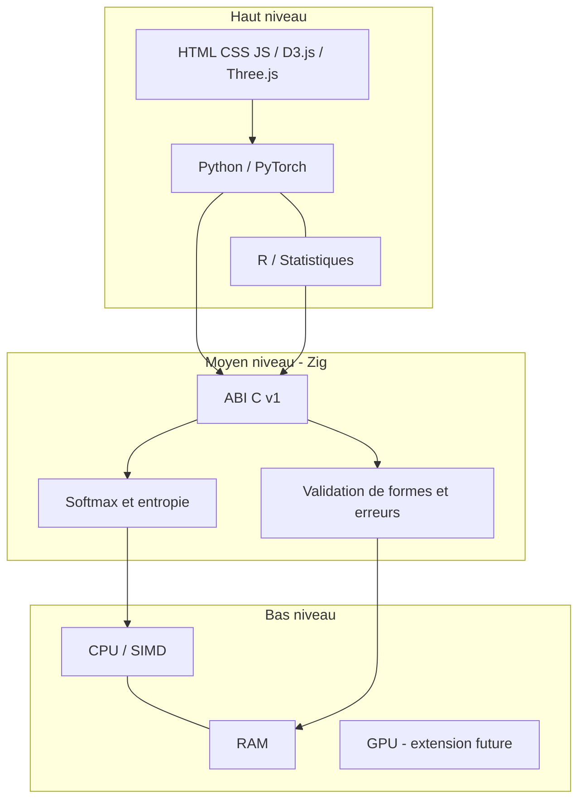

# Architecture systématique à trois niveaux

## Contrat
Chaque opération suit un schéma stable: `{operation, version, dtype, shape, parameters, input, output, diagnostics}`.
Les matrices sont en `float64` et stockées en ordre **row-major** à la frontière native. Les valeurs non finies, tailles incorrectes et dimensions incompatibles sont rejetées.

## Niveaux
1. **Bas** : CPU, SIMD, RAM, horloge monotone et accélérateurs matériels. Ne pas confondre horloge et unité arithmétique.
2. **Moyen (Zig)** : ABI C stable, validation, allocation explicite, routage de matrices et calculs élémentaires. Zig est un langage système utilisé comme middleware dans cette architecture.
3. **Haut** : Python/PyTorch (entraînement et appels natifs), R (validation statistique), HTML/CSS/JavaScript/D3.js/Three.js (présentation).

## Graphe de dépendances

## Formalisation
`S = X M^T / sqrt(d)`, `P_ij = exp(S_ij - max_k S_ik) / sum_k exp(S_ik - max_k S_ik)`, `H_i = -sum_j P_ij log(P_ij) / log(K)`.
Les invariants: `P >= 0`, `sum_j P_ij = 1`, `0 <= H <= 1` (tolérance numérique). Une frontière Zig/Python/R n'implique pas la différentiabilité automatique: les gradients PyTorch doivent rester dans PyTorch ou être fournis explicitement.

## Ordre de réalisation
1. ABI Zig minimale et tests Zig.
2. Wrapper Python avec validation des dimensions.
3. Référence R indépendante et tests de parité.
4. Sérialisation versionnée JSON pour la couche web.
5. Profilage CPU/SIMD et GPU éventuel.
6. Extension aux 30 opérateurs et aux graphes P9/P10 seulement après tests de parité.

## Limites
Le code natif est un prototype CPU; il ne remplace pas l'entraînement PyTorch. D3.js est une bibliothèque de visualisation de données et Three.js une bibliothèque 3D; ne pas les confondre.

## R as a low-level computational participant

R is high-level as a language, but R matrices may feed native Zig kernels through the `.C` pointer ABI adapter. R's column-major layout is explicitly transposed to row-major before calling Zig. The reverse conversion reconstructs the matrix with `byrow=TRUE`.

## SLP v1 protocol (experimental)

`magic=SLP1`, `version=1`, operation ID (1 softmax, 2 entropy), `dtype=1` (float64), flags=0, `rows:u32`, `cols:u32`, `payload_bytes:u64`, `request_id:u64`, followed by little-endian row-major doubles. Fixed header 32 bytes, payload maximum 128 MiB. This is a **binary framing specification**, not an implemented network transport. Never expose it directly to untrusted clients without authentication, rate limiting, checksums and robust parsing.
